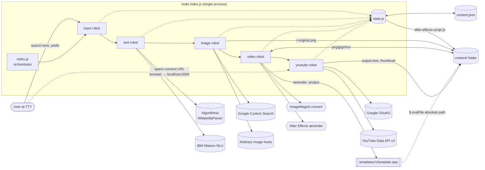
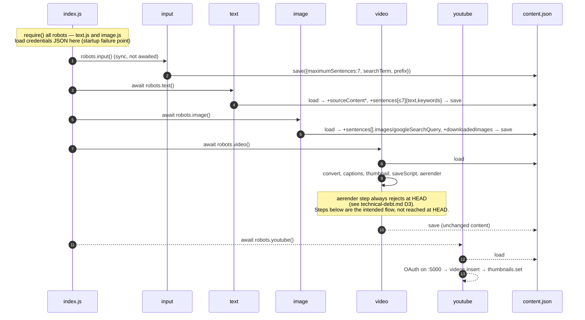
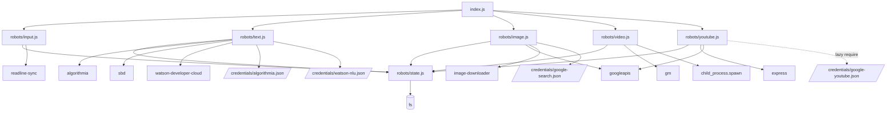

# Architecture

[← Index](README.md)

## Style

A **linear batch pipeline** inside one Node.js process. Each stage ("robot") is
a module exporting one function. Stages do not call each other. They
communicate only through state persisted to disk:

- `content.json` — the shared "blackboard" document ([data.md](data.md#contentjson)).
- `content/*` — binary artifacts (images, script, video) passed between the
  image, video and youtube stages ([data.md](data.md#files-under-content)).

The orchestrator [`index.js`](../index.js) runs the robots strictly in sequence.

## Components

| Component | File | Responsibility | Reads | Writes | External dependency |
| ----------- | ------ | ---------------- | ------- | -------- | --------------------- |
| Orchestrator | [`index.js`](../index.js) | Requires all robots at startup; runs them in order with `await`. | — | — | — |
| State | [`robots/state.js`](../robots/state.js) | Synchronous JSON persistence helpers: `save`, `load`, `saveScript`. | `./content.json` | `./content.json`, `./content/after-effects-script.js` | `fs` |
| Input robot | [`robots/input.js`](../robots/input.js) | Prompts for search term and prefix; creates a **new** content object. | stdin (TTY) | `content.json` | `readline-sync` |
| Text robot | [`robots/text.js`](../robots/text.js) | Article fetch → sanitize → sentence split → truncate to 7 → keyword extraction. | `content.json` | `content.json` | Algorithmia, IBM Watson NLU, `sbd` |
| Image robot | [`robots/image.js`](../robots/image.js) | One Google image query per sentence; download first usable image. | `content.json` | `content.json`, `content/{i}-original.png` | Google Custom Search, `image-downloader` |
| Video robot | [`robots/video.js`](../robots/video.js) | ImageMagick compositing, thumbnail, AE data script, AE render. | `content.json`, `content/*-original.png`, `templates/1/template.aep` | `content/*-converted.png`, `content/*-sentence.png`, `content/youtube-thumbnail.jpg`, `content/after-effects-script.js`, `content/output.mov` | ImageMagick (`gm`), After Effects `aerender` |
| YouTube robot | [`robots/youtube.js`](../robots/youtube.js) | OAuth2 consent via local HTTP callback; video upload; thumbnail upload. | `content.json`, `content/output.mov`, `content/youtube-thumbnail.jpg` | nothing on disk | Google OAuth2, YouTube Data API v3, `express` |
| AE template | [`templates/1/`](../templates/1) | After Effects project plus audio/image assets. Consumes the generated script and images. | `content/*` (absolute paths) | — | Adobe After Effects |

## Component diagram



## Execution sequence



Any rejected promise propagates out of `start()`, which has no `catch`
([`index.js:18`](../index.js#L18)). On Node ≥ 15 an unhandled rejection
terminates the process with exit code 1 (**verified** on Node 22: text-stage
DNS failure printed `UnhandledPromiseRejection` and exited 1).

## Codebase map

```
video-maker/
├── index.js                 Entry point (package.json "main"; `npm start` = `node .`)
├── robots/
│   ├── state.js             Persistence helpers (cwd-relative paths)
│   ├── input.js             Stage 1 — prompts
│   ├── text.js              Stage 2 — Wikipedia + sentences + keywords
│   ├── image.js             Stage 3 — Google image search + download
│   ├── video.js             Stage 4 — ImageMagick + After Effects
│   └── youtube.js           Stage 5 — OAuth + upload
├── templates/1/             After Effects project (binary) + audio/image assets
│   ├── template.aep         Comp "main"; reads content/* via absolute Mac paths
│   ├── earthmap.png, newsroom.mp3, swoosh-01.wav, swoosh-02.wav, transition-woosh-01.wav
├── content/                 Runtime artifacts (only README.md is tracked; rest git-ignored)
├── credentials/             Credential JSON files (git-ignored); README.md documents format
├── package.json             Dependencies and npm scripts
├── package-lock.json        lockfileVersion 1 (out of sync with modern npm — see development.md)
├── .gitpod.yml / .gitpod.Dockerfile   Gitpod workspace definition
└── README.md                Portuguese step-by-step setup tutorial
```

There is no `src/`, `lib/`, `test/`, `.github/` or configuration directory.

## Module dependency graph



Note the difference between eager and lazy credential loading: three credential
files are `require`d at **module load** ([`text.js:2`](../robots/text.js#L2),
[`text.js:5`](../robots/text.js#L5), [`image.js:6`](../robots/image.js#L6)),
so a missing file aborts the program before the first prompt (**verified**).
`google-youtube.json` is required inside `createOAuthClient`
([`youtube.js:42`](../robots/youtube.js#L42)), so its absence only surfaces at
the last stage, after all paid/slow work is done.

## Cross-cutting design characteristics

| Concern | How it is handled | Source |
| --------- | ------------------- | -------- |
| State | Whole-document read/modify/write of `content.json` per robot. No schema, no versioning, no locking. | [`state.js`](../robots/state.js) |
| Concurrency | None. Every network call is awaited sequentially in `for` loops. Single process, single user. | all robots |
| Configuration | Hard-coded constants (sentence count, image count, sizes, port, paths, URLs). No env vars, no flags. | see [development.md § Configuration](development.md#configuration) |
| Errors | Mostly propagate to the unhandled rejection in `index.js`. Only the image download loop catches and continues. | [`image.js:68`](../robots/image.js#L68) |
| Logging | `console.log` with a `> [robot-name]` prefix. | all robots |
| Paths | Mixed: `state.js`, `image.js`, `youtube.js` use cwd-relative paths; `video.js` resolves from repo root via `fromRoot`. **The program must be started from the repository root.** | [`state.js:2-3`](../robots/state.js#L2-L3), [`video.js:6-8`](../robots/video.js#L6-L8) |
| Resumability | Not supported by `index.js` — `input` always overwrites `content.json`. Because each robot reloads state from disk, stages can be run individually by editing `index.js` (inferred; this is how the tutorial series developed it). | [`input.js:5-11`](../robots/input.js#L5-L11) |
