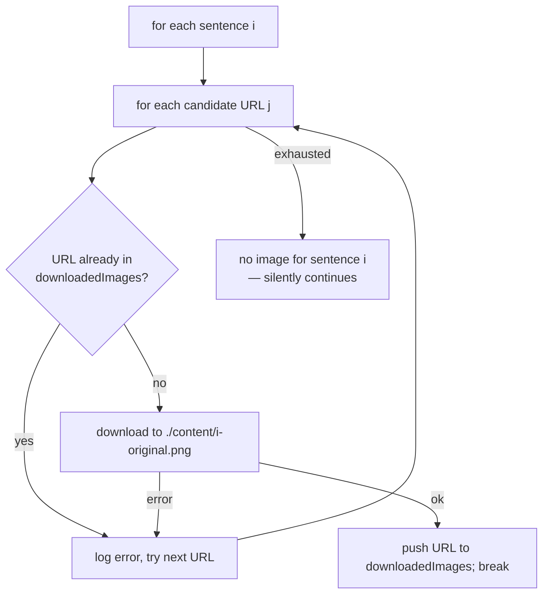
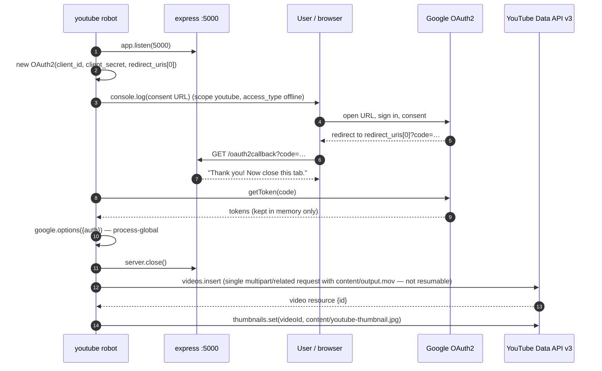

# Pipeline Implementation

[← Index](README.md) · Related: [architecture.md](architecture.md) · [data.md](data.md) · [integrations.md](integrations.md)

Each robot is a module whose default export is `async function robot()` (the
input robot's is synchronous). Inner helper functions are nested closures
inside `robot()`; nothing else is exported, so helpers cannot be unit-tested
in isolation without refactoring.

Every robot except input begins with `state.load()` and (except youtube)
ends with `state.save(content)`.

---

## 0. Orchestrator — `index.js`

```js
async function start() {
  robots.input()          // synchronous, not awaited
  await robots.text()
  await robots.image()
  await robots.video()
  await robots.youtube()
}
start()                   // no .catch()
```

- All six modules are `require`d before anything runs
  ([`index.js:1-8`](../index.js#L1-L8)). Module-level side effects at that point:
  credentials for Algorithmia, Watson and Google Search are loaded and the
  Watson client is constructed ([`text.js:1-12`](../robots/text.js#L1-L12),
  [`image.js:6`](../robots/image.js#L6)).
- No exit code handling, no signal handling, no cleanup.

## 1. Input robot — `robots/input.js`

| Step | Behaviour | Source |
| ------ | ----------- | -------- |
| Create state | `content = { maximumSentences: 7 }` — always a fresh object; previous `content.json` is overwritten. | [L5-7](../robots/input.js#L5-L7) |
| Search term | `readline.question('Type a Wikipedia search term: ')`. No validation; an empty string is accepted. | [L14](../robots/input.js#L14) |
| Prefix | `readline.keyInSelect(['Who is','What is','The history of'], …)`. | [L18-22](../robots/input.js#L18-L22) |
| Persist | `state.save(content)` | [L11](../robots/input.js#L11) |

Edge cases:

- **Cancel (`0`)** — `keyInSelect` returns `-1`; `prefixes[-1]` is `undefined`,
  so `JSON.stringify` drops `prefix` from `content.json`. The YouTube title
  later becomes `"undefined <term>"` ([`youtube.js:109`](../robots/youtube.js#L109)). *Inferred from code.*
- **No controlling TTY** — `readline-sync` reads `/dev/tty` directly and
  ignores stdin. Without a controlling terminal it throws
  `The current environment doesn't support interactive reading from TTY`
  (**verified**). The program therefore cannot be scripted by piping input.
  Under a real terminal, piped stdin is ignored and the prompt still waits on
  the terminal.

## 2. Text robot — `robots/text.js`

```mermaid
flowchart LR
    A[searchTerm] -->|Algorithmia web/WikipediaParser/0.1.2| B[sourceContentOriginal]
    B -->|drop blank lines & lines starting '='<br/>join with ' '| C
    C -->|strip parenthesised text<br/>collapse double spaces once| D[sourceContentSanitized]
    D -->|sbd.sentences| E["sentences[] = {text, keywords: [], images: []}"]
    E -->|slice 0..maximumSentences| F[≤ 7 sentences]
    F -->|Watson NLU keywords, one call per sentence| G[sentences.keywords]
```



### 2.1 `fetchContentFromWikipedia` ([L28-37](../robots/text.js#L28-L37))

Calls the Algorithmia algorithm `web/WikipediaParser/0.1.2` with the raw search
term and stores `.get().content` as `sourceContentOriginal`. Disambiguation,
language, and "not found" behaviour are decided by that remote algorithm and
are **unknown** from this repository. If `content` is missing, the next step
throws `TypeError` on `undefined.split` (*inferred*).

**Status:** the Algorithmia API host no longer resolves (**verified**,
`getaddrinfo ENOTFOUND api.algorithmia.com`). See
[integrations.md](integrations.md#algorithmia).

### 2.2 `sanitizeContent` ([L39-62](../robots/text.js#L39-L62))

- `removeBlankLinesAndMarkdown`: splits on `\n`, removes empty lines and lines
  whose trimmed text starts with `=` (MediaWiki section headings like
  `== Early life ==`), and joins the rest with a single space. Paragraph
  boundaries are lost.
- `removeDatesInParentheses`: despite the name, removes **every**
  parenthesised span, tolerating one level of nesting:
  `/\((?:\([^()]*\)|[^()])*\)/gm`, then replaces each `"  "` with `" "` once.
  **Verified** behaviour on sample input:
  - `"(born …; 10 December 1815 – 27 November 1852)"` → removed.
  - A span with two levels of nesting `(… (a(b)c) …)` is **not** removed as a
    whole (inner parts removed, outer text left).
  - Leaves `"mathematician ."` (space before punctuation) and leaves a residual
    double space when three or more spaces were adjacent.

### 2.3 `breakContentIntoSentences` ([L64-75](../robots/text.js#L64-L75))

Uses `sbd.sentences()` with default options. **Verified** that it keeps
abbreviations such as `Dr.`, `Mr.`, `D.C.`, `e.g.` and decimals inside one
sentence. Each sentence becomes `{ text, keywords: [], images: [] }`.

### 2.4 `limitMaximumSentences` ([L77-79](../robots/text.js#L77-L79))

`slice(0, content.maximumSentences)` → at most **7**. This number is a
cross-module contract: the video robot's caption layouts and the AE template
both assume indices `0..6` ([data.md § Template contract](data.md#after-effects-template-contract)).

### 2.5 `fetchKeywordsOfAllSentences` ([L81-113](../robots/text.js#L81-L113))

Sequential Watson NLU `analyze({ text, features: { keywords: {} } })` per
sentence; maps `response.keywords[].text`. Order is Watson's relevance order.
The Watson client is constructed with a **hard-coded** URL and API version
`2018-04-05` ([L8-12](../robots/text.js#L8-L12)); the `url` field in
`credentials/watson-nlu.json` is ignored.

> History note: commit `0b54e9d` changed `response.keywords` to
> `response.result.keywords`; `566c695` reverted it. For the pinned
> `watson-developer-cloud@3.18.2` (core `ibm-cloud-sdk-core@0.0.1`), the
> callback receives the parsed body as the second argument, so
> `response.keywords` is correct (**verified** in the library source).
> `.result` is the shape of the successor `ibm-watson` SDK.

Errors: Watson errors reject and abort the run. There is no handling for a
sentence that yields zero keywords; the image robot then queries
`"<term> undefined"` (see below).

## 3. Image robot — `robots/image.js`

### 3.1 Query construction ([L17-32](../robots/image.js#L17-L32))

| Sentence index | Query |
|----------------|-------|
| 0 | `searchTerm` |
| 1..n | `` `${searchTerm} ${sentence.keywords[0]}` `` (the top Watson keyword) |

The query is stored on the sentence as `googleSearchQuery`.

### 3.2 Search ([L34-48](../robots/image.js#L34-L48))

`customsearch.cse.list({ auth: apiKey, cx: searchEngineId, q, searchType: 'image', num: 2 })`
and returns `items[].link` → `sentence.images` (≤ 2 URLs).
If Google returns no results, `response.data.items` is `undefined` and `.map`
throws `TypeError`, aborting the run (*inferred*). No image-rights filter, safe
search setting, size or type filter is passed.

### 3.3 Download with fallback and de-duplication ([L50-80](../robots/image.js#L50-L80))



- Business rule: **one image per sentence, never the same URL twice** in a run.
- The file is always named `{i}-original.png` regardless of real format.
  ImageMagick detects real image formats from content, so a JPEG named `.png`
  converts fine. A non-image body (e.g. HTML) fails at conversion with
  `improper image header` (both **verified** with ImageMagick 7.1.2).
- `image-downloader@3.4.2` (verified in its source) accepts any HTTP 200/201
  with a non-empty body — no content-type check (an HTML error page is saved as
  `.png`), and the request is made without a timeout.
- **Failure mode:** if both candidates fail, no new `{i}-original.png` is
  written. The video robot will then either fail on the missing file or —
  because `content/` is never cleaned — **silently reuse a stale image from a
  previous run** (*inferred*).

## 4. Video robot — `robots/video.js`

Steps run strictly in order ([L14-18](../robots/video.js#L14-L18)). ImageMagick
is driven through `gm` with `subClass({ imageMagick: true })`, which spawns the
`convert` binary (verified in `gm@1.23.1` source).

### 4.1 `convertImage` ([L28-65](../robots/video.js#L28-L65)) — background plates

For each sentence: input `content/{i}-original.png[0]` (`[0]` = first frame, for
GIFs/multi-page files) → `content/{i}-converted.png`, 1920×1080. Algorithm:

1. Clone A: blur `0x9` (at source resolution, so the visible blur strength
   depends on the source size), then resize to **cover** 1920×1080 (`^`).
2. Clone B: resize to **fit** inside 1920×1080.
3. Composite B centred over A, then `-extent 1920x1080`.

Result: the image letter-boxed over a blurred copy of itself. **Verified** —
produced 1920×1080 sRGB PNGs with ImageMagick 7.1.2 (which prints a
`convert` deprecation warning but works).

### 4.2 `createSentenceImage` ([L73-125](../robots/video.js#L73-L125)) — caption overlays

Renders `caption:<sentence text>` in white on a transparent canvas with
kerning −1. Canvas size and gravity are fixed per index:

| Index | Size | Gravity |
| ------- | ------ | --------- |
| 0, 3, 6 | 1920×400 | center |
| 1, 4 | 1920×1080 | center |
| 2, 5 | 800×1080 | west |

There is no entry for index ≥ 7: more than seven sentences would throw
`TypeError` (`templateSettings[7]` is `undefined`). **Verified** output sizes
for indices 0 and 2.

### 4.3 `createYouTubeThumbnail` ([L127-140](../robots/video.js#L127-L140))

Re-encodes `0-converted.png` to `content/youtube-thumbnail.jpg` (1920×1080 JPEG; **verified**).

### 4.4 `createAfterEffectsScript` ([L142-144](../robots/video.js#L142-L144))

`state.saveScript(content)` writes `content/after-effects-script.js` containing
`var content = <entire content JSON>` — including the full article text.

### 4.5 `renderVideoWithAfterEffects` ([L146-178](../robots/video.js#L146-L178)) — **broken**

Intended: spawn `aerender -comp main -project templates/1/template.aep -output content/output.mov`,
stream its stdout, resolve on `close`.

Actual behaviour (**verified** by executing the same code shape):

| Platform | Result |
|----------|--------|
| `darwin` / `win32` | The branch matches (Node defines `Symbol.toPrimitive` on `os.platform`, so `os.platform == 'darwin'` works even though it is not called), but `const aerenderFilePath` is block-scoped to the `if`; `spawn(aerenderFilePath, …)` throws `ReferenceError: aerenderFilePath is not defined`, rejecting the promise. |
| anything else (Linux) | `reject(new Error('System not Supported'))`. |

Other defects in the same function, relevant once the scoping bug is fixed:

- Windows path literal uses unescaped backslashes; JavaScript turns
  `'%programfiles%\Adobe\…\aerender.exe'` into `'%programfiles%AdobeAdobe After Effects CCArquivos de suporteaerender.exe'`
  (**verified**). `%programfiles%` is also not expanded by `spawn` (no shell).
  The path also contains a Portuguese-localized folder name ("Arquivos de suporte").
- macOS path is pinned to "Adobe After Effects CC 2019".
- No `'error'` listener on the child process: a missing binary emits an
  unhandled `'error'` event, which crashes the process (*inferred* from Node semantics).
- Resolves on `close` regardless of exit code. `stderr` is piped but never
  read. A child that writes a lot to stderr could fill the pipe buffer and
  stall (*inferred*).
- Because the exit code is ignored and `content/` is never cleaned, a failed
  render followed by the youtube stage would upload a **stale `output.mov`**
  from an earlier run, if one exists (*inferred*).

The `state.save(content)` at [L20](../robots/video.js#L20) never runs when
rendering rejects. This loses nothing, because the video robot does not modify
`content`.

History: before commits on 2019-05-08 (`ea6bc4b` … `aeceb88`) the function had
a single macOS `const aerenderFilePath` at function scope (`1296ff7`), which
worked on the author's Mac.

## 5. YouTube robot — `robots/youtube.js`



### Upload payload ([L106-145](../robots/youtube.js#L106-L145))

| Field | Value |
| ------- | ------- |
| `snippet.title` | `` `${prefix} ${searchTerm}` `` |
| `snippet.description` | All sentence texts joined by blank lines |
| `snippet.tags` | `[searchTerm, ...sentences[0].keywords]` |
| `status.privacyStatus` | `'unlisted'` (hard-coded) |
| media | `fs.createReadStream('./content/output.mov')` |

`fs.statSync('./content/output.mov')` ([L108](../robots/youtube.js#L108)) runs
only *after* OAuth consent, so a missing video is discovered after the user
has gone through the browser flow.

Progress is logged as `bytesRead / fileSize`. The resulting URL
`https://youtu.be/<id>` is printed but not stored anywhere.

Assumptions not enforced by the code (external constraints, **not verified**
here): YouTube limits title length and total tag length, and custom thumbnails
require an eligible (verified) channel; violations would reject and abort
*after* the video has been uploaded.

Details on credentials and OAuth: [integrations.md § Google OAuth / YouTube](integrations.md#google-oauth2-and-youtube-data-api-v3).
Security notes on the callback server: [security.md](security.md#local-oauth-callback-server).

---

## Error handling summary

| Stage | Caught? | Effect of failure |
| ------- | --------- | ------------------- |
| Module load (missing credentials / incompatible Node) | No | Process exits before the first prompt. |
| input | No | `readline-sync` throws synchronously → unhandled rejection of `start()`. |
| text (network/API) | No | Unhandled rejection; `content.json` contains only input fields. |
| image search | No | Unhandled rejection; text results remain in `content.json`. |
| image download | **Yes**, per URL | Logged; continues with next URL/sentence. |
| video (ImageMagick) | No | Unhandled rejection. Partial files remain in `content/`. |
| video (aerender) | No | Always rejects at HEAD (see 4.5). |
| youtube | No | Unhandled rejection; server on :5000 may remain open until the process exits. |

Nothing retries, and nothing cleans up partial artifacts.
