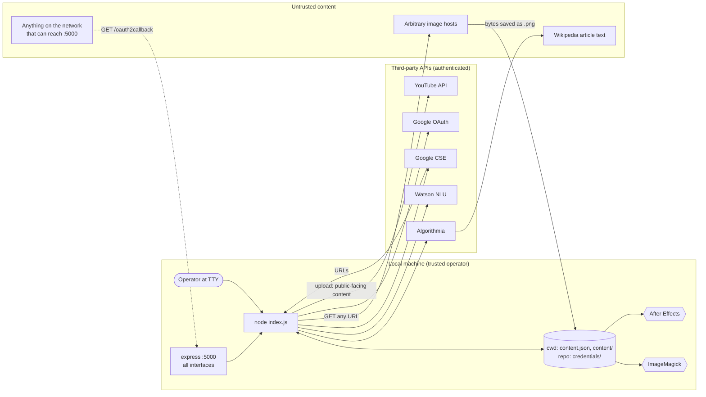

# Security and Reliability

[← Index](README.md) · Related: [integrations.md](integrations.md) · [technical-debt.md](technical-debt.md)

## Trust boundaries

Untrusted data enters at three points:

1. **Article text** (via Algorithmia). It becomes ImageMagick `caption:`
   arguments, the YouTube description, and an ExtendScript file evaluated by
   After Effects.
2. **Image bytes and URLs** (via Google results). Arbitrary hosts are fetched
   and the bytes are parsed by ImageMagick.
3. **HTTP requests to the callback port** while the youtube stage waits for
   consent.

## Secrets

| Secret | Storage | Exposure points |
| -------- | --------- | ----------------- |
| Algorithmia API key | `credentials/algorithmia.json` | Read at startup. Sent to Algorithmia. |
| Watson IAM API key | `credentials/watson-nlu.json` | Read at startup. Exchanged for IAM tokens by the SDK. |
| Google API key + engine id | `credentials/google-search.json` | Sent as a query parameter to Google. |
| OAuth client id/secret | `credentials/google-youtube.json` | Used in the token exchange. |
| OAuth authorization code | memory | **Printed to stdout** ([`youtube.js:68`](../robots/youtube.js#L68)). Short-lived and single-use. |
| OAuth access/refresh tokens | memory only, process-global `google.options` | Never written to disk (good). Lost at exit. |

Findings:

- **`credentials/README.md` contains realistic-looking credential values.**
  Its Algorithmia and Watson examples are not obvious placeholders: a
  key-shaped string, and IBM CRNs containing an account and service-ID. This
  repository cannot determine whether they were ever live. The git history
  keeps them regardless of later edits. Recommendation: treat them as
  compromised (revoke if they belong to you), replace them with placeholders
  like `"<YOUR_API_KEY>"`, and do not copy them. These docs deliberately do
  not reproduce them.
- `.gitignore` excludes `credentials/*.json`, `content.json` and generated
  content, which keeps working credentials out of commits.
- **`pkg` builds likely embed credentials** (*inferred*): the credential files
  are loaded via static `require('../credentials/*.json')`, which `pkg`
  bundles into the executable snapshot. Distributing a built binary would
  distribute your keys and OAuth client secret.
- The generated `content/after-effects-script.js` holds the full article
  text, but no secrets.

## Attack surface and risks

### Local OAuth callback server

[`youtube.js:25-74`](../robots/youtube.js#L25-L74)

- `app.listen(5000)` without a host binds to **all interfaces**, not only
  loopback. While waiting for consent, any host that can reach the machine
  can call `/oauth2callback`.
- No OAuth `state` parameter is generated or checked, so the first request
  that arrives wins. A party who sends their own valid authorization code
  (issued for this client id) could make the tool upload to **their**
  account. A garbage code makes `getToken` fail and aborts the run. Impact is
  low for a personal tool, but this is a textbook OAuth CSRF/code-injection
  gap (*inferred*).
- No PKCE.
- `?error=access_denied` is not handled. The run fails later in `getToken`.

Recommendation: listen on `127.0.0.1`, add and verify a random `state`, and
handle `req.query.error`.

### Least privilege

The OAuth scope `https://www.googleapis.com/auth/youtube`
([`youtube.js:56`](../robots/youtube.js#L56)) grants full YouTube account
management. Video upload alone needs `youtube.upload`. Thumbnail upload
accepts `youtube.upload` per Google's scope docs (**not verified** here).
`access_type: 'offline'` requests a refresh token that is never used.

### Image downloading

- Fetches any URL that Google returns, with no allow-list, size limit,
  timeout, or content-type check (`image-downloader@3.4.2` buffers the whole
  body in memory; **verified** in its source).
- The bytes go straight to ImageMagick, a large parser surface with a history
  of CVEs in its decoders and delegates. Hardening relies entirely on the
  system's ImageMagick `policy.xml` (**unknown** per machine).

### ImageMagick arguments

`gm@1.23.1` passes arguments as an array to `cross-spawn`
(`gm/lib/command.js:6`). On Unix this means no shell, so shell injection
through sentence text is not possible. On Windows, `cross-spawn` may route
through `cmd.exe` with its own escaping (*inferred*; not tested). ImageMagick still interprets some argument syntax itself.
A `caption:` value that starts with `@` is read as a **filename**. A sentence
beginning with `@` would make ImageMagick render a local file's contents into
the video (*inferred*, low likelihood with Wikipedia prose; many distro
policies disable `@` reads).

### Code evaluated by After Effects

`after-effects-script.js` is built by `JSON.stringify`, so article text cannot
break out of the string literal into script code. One caveat: unescaped
U+2028/U+2029 can cause a parse error in older ExtendScript, which is a
reliability problem, not a breakout ([data.md](data.md#after-effects-template-contract)). The template then runs
`$.evalFile` on a hard-coded absolute path. Anyone who can write that path on
the rendering machine can run ExtendScript inside After Effects.

### Dependencies

`npm audit --omit=dev` on a scratch install (2026-10-23) reported **37
vulnerabilities (5 critical, 19 high, 9 moderate, 4 low)**. Most come from the
pinned 2019-era tree: `request` (deprecated, used by `image-downloader` and the
Watson SDK), `node-forge`, `tough-cookie`, and others. `watson-developer-cloud`
is deprecated on npm in favour of `ibm-watson`. Not every advisory is
reachable from this code. No triage was done.

### Content and licensing exposure

The image robot pulls arbitrary Google Image results with no usage-rights
filter, and the youtube robot publishes them (unlisted, but viewable by anyone
with the link). The text is Wikipedia content (CC BY-SA), and the description
gives no attribution. These are legal and policy risks, not code defects, and
the code does nothing to mitigate them.

## Reliability and failure modes

| Failure mode | Behaviour | Source |
| -------------- | ----------- | -------- |
| Any unexpected error | Unhandled promise rejection; process exits 1 on Node ≥ 15 (verified on 22). No cleanup. | [`index.js:18`](../index.js#L18) |
| Slow or hung image host | Download has no timeout, so the run can hang indefinitely (*inferred*). | `image-downloader` → `request` |
| API rate limits or quotas (CSE, Watson, YouTube) | No retry or backoff. The first error aborts. | all robots |
| Stale artifacts | `content/` is never cleaned, so earlier runs' images, and even an old `output.mov` after a failed render, can be reused or uploaded silently. | [`image.js:64`](../robots/image.js#L64), [`youtube.js:107`](../robots/youtube.js#L107) |
| Non-atomic state writes | `writeFileSync` to `content.json`; a crash mid-write can corrupt it (*inferred*). | [`state.js:7`](../robots/state.js#L7) |
| Render exit status | `aerender` exit code and stderr are ignored, so a failed render looks like success until the youtube stage fails on the missing `output.mov`. | [`video.js:169-176`](../robots/video.js#L169-L176) |
| Child-process spawn error | No `'error'` listener, so a missing binary crashes the process (*inferred*). | [`video.js:163`](../robots/video.js#L163) |
| Partial success at the youtube stage | The video uploads, then the thumbnail fails. The run aborts, and re-running uploads a duplicate. | [`youtube.js:12-14`](../robots/youtube.js#L12-L14) |
| Callback server lifecycle | Closed only on the success path. On error the process exits anyway. | [`youtube.js:23`](../robots/youtube.js#L23) |
| Concurrent runs in one directory | They share `content.json`, `content/` and port 5000. Unsupported; outputs would collide. | — |
